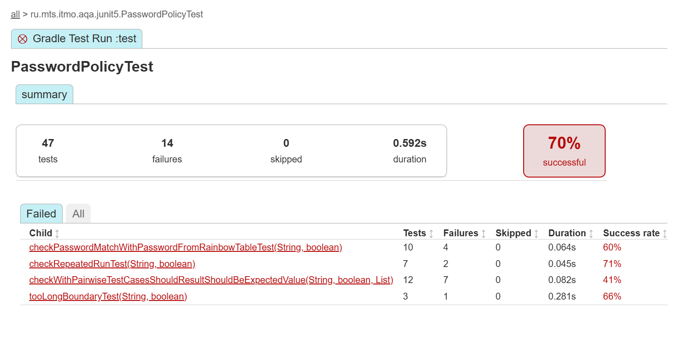
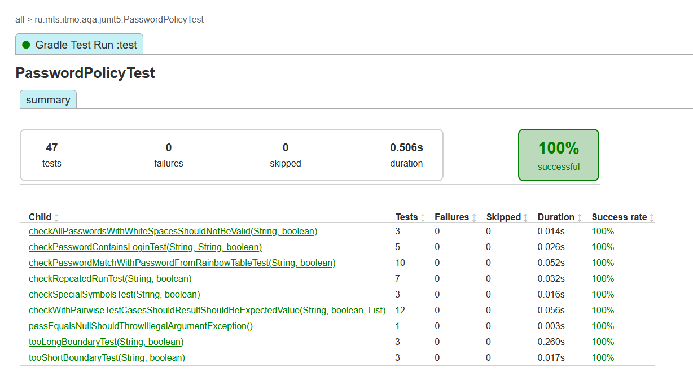
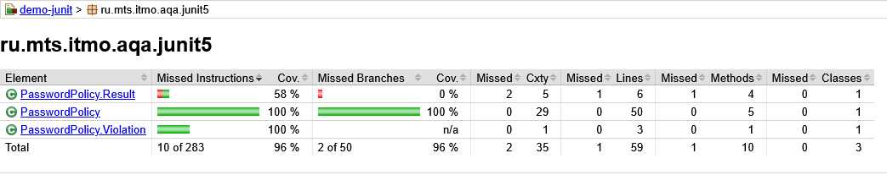
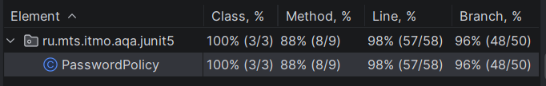
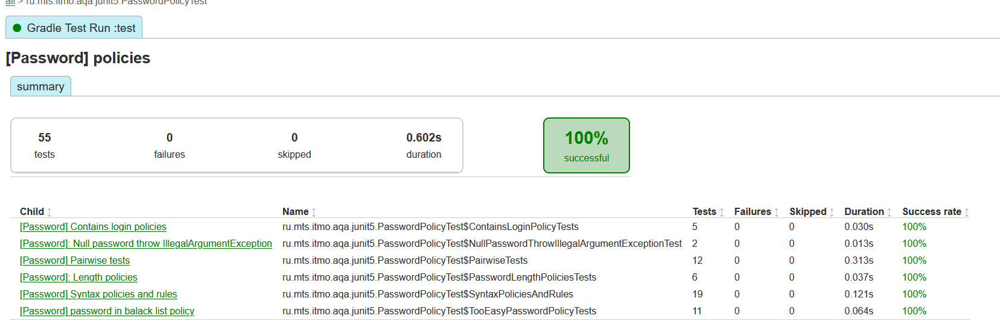
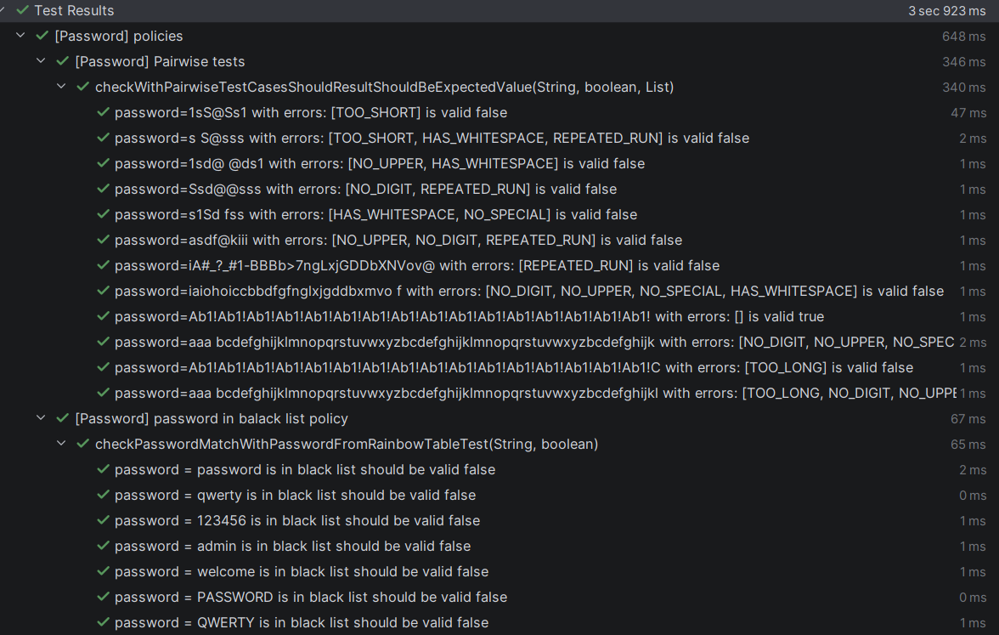
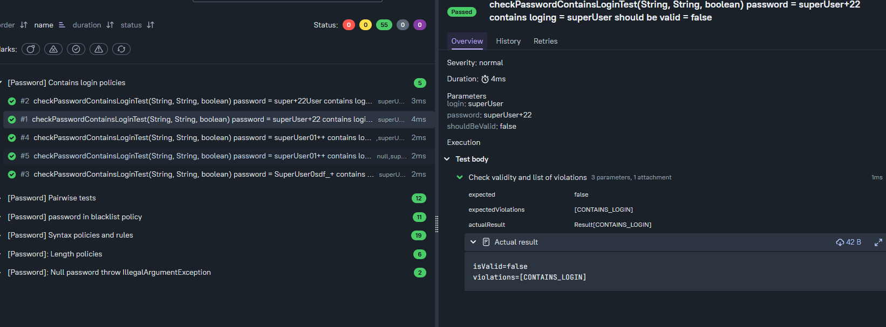

# demo-junit — учебный проект занятия 3-4

## Тестовая модель для `PasswordPolicy`

### Классы эквивалентности

| Правило | Не валидный | Валидный |
|---|---|---|
| Пароль равен `null` | `password == null` | `password != null` |
| `TOO_SHORT` | длина меньше 8 | длина не меньше 8 |
| `TOO_LONG` | длина больше 64 | длина не больше 64 |
| `NO_DIGIT` | нет цифр | есть цифра |
| `NO_UPPER` | нет заглавных латинских букв | есть заглавная латинская буква |
| `NO_LOWER` | нет строчных латинских букв | есть строчная латинская буква |
| `NO_SPECIAL` | нет символов из `!@#$%^&*()-_=+` | есть символ из этого набора |
| `HAS_WHITESPACE` | есть пробельный символ | нет пробельных символов |
| `REPEATED_RUN` | серия из 3 и более одинаковых символов | серии не длиннее 2 символов |
| `CONTAINS_LOGIN` | непустой логин содержится в пароле без учёта регистра | логин не содержится, пуст или не передан |
| `BLACKLISTED` | пароль совпадает с элементом списка без учёта регистра | пароль не совпадает с элементами списка |

### Граничные значения

| Проверяемая граница | Значение перед границей | Значение на границе | Значение после границы |
|---|---|---|---|
| Минимальная длина 8 | 7  `TOO_SHORT` | 8 допустимая длина | 9 допустимая длина |
| Максимальная длина 64 | 63 допустимая длина | 64 допустимая длина | 65 `TOO_LONG` |
| Серия одинаковых символов | 2 допустимо | 3 `REPEATED_RUN` | 4 `REPEATED_RUN` |

---
### Запуск тестов
```
gradlew.bat clean test
```
Отчет до исправлений


Для каждого выделенного bug-report реализовал фикс в классе PasswordPolicy.  
После повторного запуска `gradlew.bat clean test` все тесты зелёные

Покрытие тестами:



---
### commit 71422da5d02cec6fbbe503f311eb854b41afa75b (HEAD -> lab-1) 
Для выполнения пунктов Полнота и Читаемость добавил тесты и аннтотации



---
### Добавляю Allure
